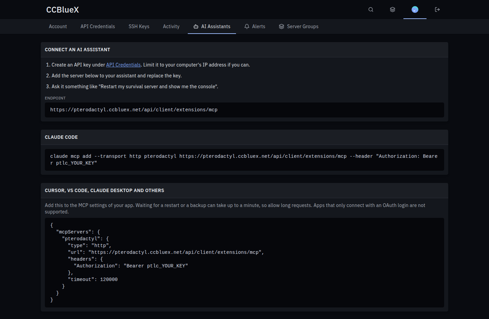

# MCP for Pterodactyl

[](https://github.com/CCBlueX/Pterodactyl-Extension-MCP/releases/latest)
[](https://github.com/CCBlueX/Pterodactyl-Extension-MCP/releases)
[](https://pterodactyl.io)
[](LICENSE)

Let AI assistants like Claude manage your game servers over the [Model Context Protocol](https://modelcontextprotocol.io).



## Install

1. Download `mcp-<version>.pteroext` from the [latest release](https://github.com/CCBlueX/Pterodactyl-Extension-MCP/releases/latest).
2. Open **Admin → Extensions**, click **Install** and pick the file.
3. Enable it. Users find the setup steps under **Account → AI Assistants**.

## Features

- **Normal API keys**: assistants sign in with a Client API key, so they get exactly the user's permissions.
- **Everything a server needs**: console commands with their output, power with waiting, files (read, search, edit, upload), backups, startup, network, databases, schedules and subusers.
- **Changes on request**: tools that change anything stay off until an administrator allows them. Root admins can also get node and server administration.
- **Logged**: every action shows up in the server's activity log, marked as coming from MCP.
- **Works everywhere**: Claude Code, Cursor, VS Code, Claude Desktop, OMP and any client that speaks Streamable HTTP.

```sh
claude mcp add --transport http pterodactyl https://panel.example.com/api/client/extensions/mcp --header "Authorization: Bearer ptlc_YOUR_KEY"
```

| Setting | Default | What it does |
|---|---|---|
| Allow changes | off | Adds the tools that write files, back up, change startup, network, databases, schedules and subusers. |
| Allow administration | off | Root admins get node, egg and server administration tools. |
| Largest text answer | 256 KB | The most text one `read_file` answer returns. |
| Largest file transfer | 16 MB | The largest file `read_file` searches or returns as base64, and `write_file` accepts as base64. |

---

Inspired by the Pelican plugin AI Server Control (MCP).
